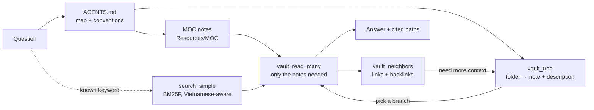
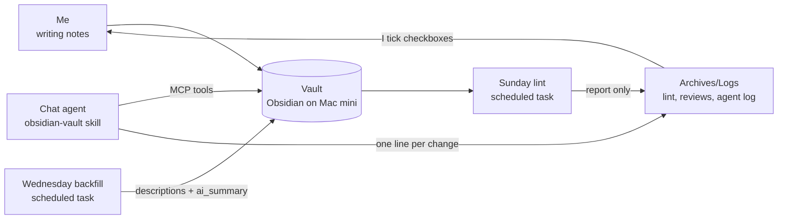

## 1. Context: a second brain that nobody else could read

My Obsidian vault is about five years old and holds roughly 1,950 notes. It follows the PARA structure from _Building a Second Brain_: `Projects/`, `Areas/`, `Resources/`, `Archives/`. On paper, that's very organised. In practice, `Resources/` was a flat folder of about 1,770 notes, sharing space with 281 screenshots called things like `Untitled 188.png`.

That was fine while I was the only reader. I know where things are, more or less. Then I connected the vault to Claude through the [Local REST API with MCP](https://github.com/coddingtonbear/obsidian-local-rest-api) plugin running on my Mac mini, and asked it questions about my own notes. Watching an agent try to use my vault was humbling:

- It called `vault_list` on `Resources/` and got back a thousand-plus entries, a quarter of them images.
- It guessed note names, opened them one by one, and still didn't know what a note was _about_ until it had read it.
- It searched for `thể chế hóa` (Vietnamese for "institutionalisation") and got **361 matching files**. The note actually called `Thể chế hóa` wasn't in the top 5.

The obvious fix is "just add RAG": chunk everything, embed it, put a vector DB in front. I didn't want that. I wanted to find out how far I could get without it, and to keep the vault in a state I could still reason about myself.

This post covers what I built over one long weekend: a fork of the plugin, a search engine that understands Vietnamese, a handful of tools designed for agents, and a vault cleanup that now runs on a schedule. I did it pair-programming with Claude. The agent wrote most of the code and ran most of the migrations; I made the calls and caught the mistakes. That split matters later.

## 2. Architecture and mental model

### Vectorless RAG, but the tree already exists

[PageIndex](https://github.com/VectifyAI/PageIndex) popularised the term "vectorless RAG". Instead of chunking and embedding a document, you build a table-of-contents tree and let the LLM _reason_ about which branch to open. Karpathy's [LLM Wiki gist](https://gist.github.com/karpathy/442a6bf555914893e9891c11519de94f) applies the same idea to a knowledge base: keep an `index.md` with one summary line per page, let the model read the index first, then drill down.

A vault already has that tree: folder → note → heading. The only thing missing is the one-line summary per node. Once every note has a `description` in its frontmatter, the folder tree _is_ the index.

The mental model I settled on: **treat the vault like a codebase and the agent like a new hire.** A new engineer doesn't need embeddings to find their way around a repo. They need a `README`, a directory tree with comments, and a decent `grep`. For the vault, those became `AGENTS.md`, `description` fields, and a BM25 search that doesn't fall apart on Vietnamese.

This isn't a contrarian take, either. According to [this write-up on why coding agents don't use RAG](https://labuladong.online/en/interview/agent/coding-agent-rag/), Claude Code itself moved away from a vector index to agentic search (glob, grep, read) because it worked better in practice.



The top path is the "vectorless" part: the agent walks the tree. The dotted path is the shortcut when the question already contains a good keyword. Both end at `vault_read_many`, so the agent opens a handful of notes in one round trip instead of ten.

### Three layers

| Layer       | What it is                                                                     | Where it lives                                   |
| ----------- | ------------------------------------------------------------------------------ | ------------------------------------------------ |
| Metadata    | `description` on every note, normalised tags, MOCs, `AGENTS.md`                | The vault itself                                 |
| Tools       | Deny-list, BM25 search, tree/neighbors/batch-read, lint and bulk-edit tools    | A fork of the plugin, running inside Obsidian    |
| Maintenance | Scheduled lint, weekly description backfill, agent skills, an agent change log | Scheduled agent runs + files in `Archives/Logs/` |

## 3. Step-by-step walkthrough

### 3.1 Fork the plugin, and give the fork its own name

My first plan was an extension: the plugin exposes an API (`addMcpTool`) so other plugins can register extra MCP tools. That died quickly. An extension can _add_ tools, but it can't _filter or replace_ the built-in ones. My two most important changes were exactly that: a deny-list on every route, and a rewrite of the existing `search_simple`.

So I forked it: [minhdqdev/minhdq-local-rest-api](https://github.com/minhdqdev/minhdq-local-rest-api). The first version kept the upstream plugin `id`, and I caught that before shipping it. Obsidian identifies a plugin by its `id`, so one click on "Update" in the community plugins screen would silently replace my fork with upstream, taking the deny-list with it. The fork now ships as `minhdq-local-rest-api`, versioned `5.5.2-minhdq.N`. Upstream updates show up as upstream updates and never touch it.

The whole fork comes to 8 commits, 34 files changed and about 3,300 lines added, with 1,450 tests passing.

### 3.2 A deny-list that actually denies

The vault has a `Resources/Private/` folder with personal documents I never want an agent to read. Telling the agent in a prompt is pointless: anything with read access to a clipped web article can be prompt-injected. The block has to sit in the server.

The fork adds an **Excluded paths** setting (one glob per line). It is enforced in every place a path enters or leaves the plugin: file reads and writes, directory listings, search, links and backlinks, the event stream, the "active file" endpoint, and the move/copy destinations. Hitting an excluded path returns error `40322`, and excluded files never show up in listings or search results in the first place.

```text
# Settings → Excluded paths
Resources/Private/**
```

Pattern matching runs on a canonical form of the path: NFC-normalised and case-folded, the same way macOS compares filenames. Without that, `resources/private/x.md` or a decomposed Unicode spelling could slip past a rule written as `Resources/Private/**`:

```ts
function compileExcludedPattern(pattern: string): RegExp | null {
  const trimmed = pattern.trim().replace(/^\/+/, '')
  if (!trimmed) return null
  const canonical = canonicalNameForm(trimmed.replace(/\\/g, '/'))
  // ...translate **/, *, ? into a regex...
  // A bare folder name ("Private" or "Private/") means the folder and its contents.
  if (!/[*?]/.test(canonical)) re = `${re.replace(/\/$/, '')}(?:/.*)?`
  return new RegExp(`^${re}$`, 'u')
}
```

### 3.3 A search engine that speaks Vietnamese

The built-in simple search is Obsidian's fuzzy matcher: it matches each word of the query separately and loosely. For English that's tolerable. For Vietnamese it's a disaster, because Vietnamese is written in short syllables that differ only by diacritics:

- `thể`, `thế`, `the` are different words.
- `cung` (supply) and `cùng` (together) are different words.
- `hoá` and `hóa` are the **same** word. The tone mark just sits on a different vowel: older style versus newer style, and both are all over my notes.

So the replacement has to get two things right at once: conflate spellings that are really the same word, and keep apart words that only look similar once you strip the accents. The fork indexes every token under two keys:

- **Accent key**: NFC, lower case, vowel marks kept (`â ă ê ô ơ ư đ`), and the tone mark moved off the vowel to the end of the syllable. `hoá` and `hóa` both become `hoa~1`, while `cung` and `cùng` stay apart.
- **Fold key**: every diacritic removed, `đ` → `d`. This exists so that `san pham` (typed without accents) still finds `sản phẩm`.

```ts
const TONE_MARKS: Record<string, string> = {
  '̀': '2', // huyền
  '́': '1', // sắc
  '̃': '4', // ngã
  '̉': '3', // hỏi
  '̣': '5', // nặng
}

export function accentKey(token: string): string {
  const decomposed = token.normalize('NFD')
  let tone = ''
  const base = decomposed.replace(TONE_RE, (mark) => {
    tone = TONE_MARKS[mark] ?? tone
    return ''
  })
  const recomposed = base.normalize('NFC')
  return tone ? `${recomposed}~${tone}` : recomposed
}
```

Scoring is BM25F: BM25 computed per field, with a weight for each field. A match in the file name should count for far more than a match buried in a paragraph.

| Field             | Boost | Why                                             |
| ----------------- | ----- | ----------------------------------------------- |
| Title (file name) | 6     | The name is usually exactly what the user types |
| Alias             | 5     | Alternate names are titles too                  |
| Heading           | 2.5   | Headings summarise sections                     |
| Frontmatter/meta  | 2.5   | `description` lives here                        |
| Tag               | 2     | Deliberate, but coarse                          |
| Body              | 1     | Everything else                                 |

On top of that:

- **Fold-key matches are discounted.** They get weight 0.3 when the query term has diacritics (the user was specific, so respect it) and 0.7 when it doesn't (the user probably just didn't type accents).
- **Adjacent query terms that appear next to each other** score ×1.5 (a bigram phrase boost).
- A **coverage penalty** (squared) pushes down documents that match only a few of the query terms.
- A **title bonus** applies when the whole query appears in the title.

Before and after, same vault, same query:

| Query                 | Before (Obsidian fuzzy search)               | After (fork)                                                         |
| --------------------- | -------------------------------------------- | -------------------------------------------------------------------- |
| `thể chế hóa`         | 361 matching files, target note not in top 5 | `Thể chế hóa.md` #1 (score 1633), its `hoá` twin #2 (1172), #3 at 59 |
| `nguon cung san pham` | Not measured                                 | `Nguồn cung sản phẩm công nghệ ngách.md` #1 (636), #2 at 57          |

Notice the second hit for the first query: the vault had _two_ notes, `Thể chế hóa.md` and `Thể chế hoá.md`. The new search ranks both at the top, which is correct and also exposes a duplicate I had never noticed. Spotting this kind of thing became a lint check (3.5).

Matches inside the body also report the heading path they sit under (`I. Xu hướng trong năm tới > Ví dụ …`), so the agent can do a targeted read of one section instead of the whole note.

The index lives in memory inside Obsidian. Before each search it compares every file's identity, mtime and size against a stored stamp, and re-indexes only what changed. It rebuilds from scratch only when the deny-list changes. No SQLite, no embeddings, nothing to keep in sync outside the app.

### 3.4 Tools shaped for agents, not for humans

The upstream plugin ships about 20 low-level tools (list, read, patch, search…). They're complete, but they're shaped like a filesystem API. I added tools shaped like the questions an agent actually asks. The last three in the table came out of the agent's own review in section 3.7:

| Tool                      | What it does                                                                                                                                   | Replaces                        |
| ------------------------- | ---------------------------------------------------------------------------------------------------------------------------------------------- | ------------------------------- |
| `vault_tree`              | Folder → notes, each with its one-line description; depth and size limits; hides images                                                        | Repeated `vault_list`           |
| `vault_read_many`         | Several notes in one call, truncated per file, per-file errors                                                                                 | N × `vault_read`                |
| `vault_neighbors`         | Links and backlinks, 1–2 hops, each with a description                                                                                         | Reading notes just to see links |
| `search_simple`           | The BM25F engine above, plus `path`/`tags` filters, `mode: all \| phrase`, `compact` output, heading paths on matches                          | Obsidian's fuzzy search         |
| `recent_changes`          | Notes changed since `7d`, `24h` or an ISO date                                                                                                 | Nothing                         |
| `vault_lint`              | Report on broken links, orphans, stubs, missing descriptions, unreviewed AI descriptions, hoá/hóa duplicates, tag variants, broken frontmatter | Manual audits                   |
| `frontmatter_update_many` | Set or unset frontmatter on many notes; **dry run by default**                                                                                 | N × `vault_patch`               |
| `tag_rename`              | Rename a tag in frontmatter and inline, nested tags too, skipping code blocks; **dry run by default**                                          | Find and replace                |
| `note_find`               | "Does a note called X exist?" Matches titles and aliases only, graded `exact` / `folded` / `contains` / `similar`                              | Guessing from search results    |
| `search_related`          | Notes sharing the most distinctive words with a note or a text, flagged if already linked                                                      | Hand-picked keyword searches    |
| `vault_batch`             | Up to 50 write/append/patch operations in order, each with its own `ifMatch`; stops at the first failure                                       | One call per write              |

In my experience the design rule that mattered most is **every bulk write defaults to a dry run**. An agent that can rewrite 100 notes in one call is great right up until the moment it's wrong. A dry run shows the before and after for each note, and my agent rules say: if more than ~20 notes change, show me the dry run and wait for a yes.

A few existing tools also got smaller upgrades. `vault_write` takes frontmatter as a JSON object and writes the YAML itself, so agents stop hand-escaping quotes. `tag_list` takes `prefix`, `query`, `minCount` and `limit`, because the vault has hundreds of one-off tags. And `vault_lint` accepts the path of a single note, so an agent can check the note it just wrote.

### 3.5 Vault hygiene: making the metadata layer real

Tools don't help if the metadata is garbage, and mine mostly was. This part was less clever and more janitorial.

**`AGENTS.md` at the vault root.** The map: what each PARA folder holds, where new notes go, frontmatter and tag conventions, which folders are personal ("ask before reading `Areas/`"), and the rules. It is the single source of truth for conventions; everything else points to it.

**An agent change log.** Every change an agent makes adds one line to `Archives/Logs/Agent log.md`. Karpathy's gist has the same idea (`log.md`). When something looks off three weeks from now, I want `grep`, not archaeology.

```text
- 2026-11-22 cleanup moved 281 loose images (Untitled N.png etc.) from Resources/ root to Archives/Assets/ …
- 2026-11-22 lint stub review: 234 short notes with a suggestion each (tick to approve), no note changed → [[Stub review 2026-11-22]]
```

**Descriptions.** I backfilled a one-line `description` (≤150 characters, "what does this note answer?") for 201 notes so far: everything at the root and in `Projects/`, plus all 119 AWS notes. Every agent-written description carries `ai_summary: true`, so an Obsidian Bases view lists them for me to review and rewrite. The rest of `Resources/` gets backfilled one topic cluster per week (3.6).

**Tags.** Ten groups of duplicates merged in 101 files: `AI`/`artificial-intelligence` → `ai`, `LLM` → `llm`, `inprogress` → `in-progress`, and my personal favourites `project-mangement` and `coporate`.

**Images.** All 281 loose images left `Resources/` for `Archives/Assets/`, which is the attachment folder Obsidian was already configured to use. Section 4 has the story of why this was harder than `mv`.

**Stubs.** 234 notes have a body under 300 bytes. Some are empty templates, some are a single link, some are short but genuinely useful. I didn't let the agent delete anything. It wrote a review note with one checkbox per stub and a suggestion: delete, merge into an existing note, expand, or keep. I tick the lines I agree with, and the agent applies only those.

**MOCs.** Three maps of content in `Resources/MOC/`: AI & LLM (92 notes), System Design (129) and Blockchain (101). They're built deterministically, by grouping notes on tags and name patterns, and each link carries a one-line description. They're marked `generated_by: agent`. This follows a lesson from the LLM Wiki discussion: an index an LLM rewrites freely drifts away from reality. A generated tree plus LLM-written leaf summaries stays honest.

**The root folder.** About 80 files had piled up at the vault root, which PARA doesn't have a slot for. They went where they belong: research notes to `Resources/`, drafts to `Resources/Posts/`, projects to `Projects/`, this year's OKRs and work log to `Areas/`, and each Bases dashboard next to the notes it shows. The root now holds `AGENTS.md`, and `AGENTS.md` says never to create notes there.

### 3.6 Keeping it clean without me

A cleanup that depends on me remembering to do it has a half-life of about two weeks. So the maintenance layer runs as scheduled agent tasks:

| Job                         | When              | What it does                                                                                                     |
| --------------------------- | ----------------- | ---------------------------------------------------------------------------------------------------------------- |
| Weekly vault lint           | Sunday morning    | Runs `vault_lint` and `recent_changes`, compares with last week, writes a report note. Never edits notes.        |
| Weekly description backfill | Wednesday evening | Picks the largest cluster of `Resources/` notes without descriptions (≤100), writes descriptions after a dry run |
| Search miss review          | Once, a month in  | Reads the search log and decides whether I actually need semantic search                                         |

Each job's prompt is written to run in a fresh session with no memory of this one. It states exactly which keys it may write, and it stops cleanly if Obsidian isn't reachable rather than trying to be creative.

The same rules are packaged as **agent skills**, so any new chat behaves the same way:

- An `obsidian-vault` skill holds the procedure: read `AGENTS.md` first, the order to call tools in, write rules, dry runs for bulk edits, and what to do via shell when the API can't.
- A `vault-ingest` skill takes a URL or clipped article: it saves the source, appends a distilled summary, links it from related notes, and logs the change. It never rewrites my own prose.
- My `/research` skill now asks whether the result should be a markdown file or a note in the vault, instead of assuming.



### 3.7 Letting the agent review its own tools

Two days of building tools for agents, and I had never asked the agent what it actually needed. So after an ordinary task, I asked it.

The task was ingesting two sources: Tencent's HY-World 2.0 (a model that generates 3D worlds) and NVIDIA's SimReady Central (a search over 3D simulation assets). The `vault-ingest` skill does the usual sequence: check for duplicates, save each source, distill it, link it into related notes, log it. It finished. Then I asked: "Do you need more or better tools to work with the vault?"

The answer was a ranked list of six, and every item came from friction it had just hit:

1. **Dedupe by exact name.** `search_simple` scores words independently. Checking whether "HY-World 2.0" existed returned "Software 2.0" and "OAuth 2.0". Checking "SimReady Central" returned a note about "central server". It said it couldn't safely conclude "no such note" from that.
2. **Compact output.** By default each hit came back with up to ten matches plus context, which costs a lot of tokens when all it needs is to choose which notes to open.
3. **Related-note search.** It found the two right notes to link (Physical AI and my Robotics Infra Roadmap) only because it happened to guess "Isaac Sim" as a query. "world model 3D Gaussian Splatting" found nothing useful.
4. **Filters on `tag_list`.** More than 500 tags, most of them used once.
5. **Frontmatter as an object.** Hand-writing YAML inside a `vault_write` string breaks on quotes.
6. **Batched writes.** One ingest took a write per source, a patch per related note and an append for the log.

It added one more thing it couldn't do: run `vault_lint` on just the two new notes.

All of these were cheap to build because the index already existed. `note_find` compares names using the same accent and fold keys as search, plus light plural folding, so "world model" matches "World models". The `mode: phrase` filter reuses the bigram postings the phrase boost already kept. `search_related` is a lexical "more like this": it takes the note's text (title words counted three times), ranks words by tf-idf against the vault, and runs them as one loose query with a softer coverage penalty. Five of the six requests, plus single-note lint, shipped the same day as `5.5.2-minhdq.5`.

The one request I didn't fully build was the semantic version of item 3. Embeddings might have rescued the Gaussian Splatting query, but I've already decided that question gets settled by a month of search-miss data, not by one anecdote. The agent's own suggestion pointed at the same scheduled review.

The lesson I'd generalise: **the agent is the user of these tools, so ask it.** Its feedback was specific, ranked, and backed by evidence from the session, which is more than most human bug reports manage. The same loop now runs inside the workflow: whenever a search misses, the agent writes a line in the misses log.

## 4. Failure stories and gotchas

**The fork that would have un-forked itself.** Covered above, and worth repeating: if you fork an Obsidian plugin, change the `id` in `manifest.json` on day one. Same `id`, same plugin, as far as Obsidian is concerned.

**The release script that released upstream.** My `release.sh` used `gh repo view` to work out which repo to publish to. Inside a fork, `gh` resolved the _parent_ repo. The script ran, said nothing useful, and no release appeared on my fork. The fix is to derive the repo from `origin`'s URL instead:

```bash
FULL="$(git remote get-url origin | sed -E 's#^(https://github\.com/|git@github\.com:)##; s#\.git$##')"
gh repo set-default "$FULL" >/dev/null
```

**macOS filenames are NFD.** Filenames that came from the shell were decomposed Unicode (`ế` stored as `e` + two combining marks). Names that came through the Obsidian API were NFC. Comparing the two produced "file not found" for files that were obviously there. The search tokenizer now accepts combining marks inside tokens (`[\p{L}\p{M}\p{N}]+`) and normalises everything to NFC before indexing. All my migration scripts now normalise both sides before comparing.

**Moving 281 images called `Untitled N.png`.** Old Notion exports name every image `Untitled.png`, `Untitled 1.png`… The vault had dozens of files called `Untitled 1.png`, one per old course folder. An embed like `![[Untitled 1.png]]` doesn't say which one it means; Obsidian resolves it by a "closest match" rule. A plain `mv` would have silently rewired some embeds to the wrong image. What worked:

1. Scan every link in the vault and classify each image.
2. Images with a unique name (259): plain `mv`. A bare `[[name]]` still resolves to the only file with that name.
3. Images with a shared name (22): move them through Obsidian's own rename API, which knows which links currently point to _this_ file and rewrites exactly those. It touched 4 notes.

**Text before the frontmatter.** Two notes had a stray word typed before the opening `---`. One of them started with `QUic`. Obsidian then treats the whole frontmatter block as body text, so the note's tags and description silently stop existing. `vault_lint` now reports this as `brokenFrontmatter`.

**"Delete this key" left `key: null`.** The first version of `frontmatter_update_many` removed keys by replacing their value with null, which leaves `description: null` in the YAML. Deleting has to remove the key along with its value.

**Heuristics are suggestions, not decisions.** The first pass of the stub review classified notes with regexes, and the regexes were wrong in instructive ways. Stripping template boilerplate also ate real content. "Live Comment System Design" was flagged as a duplicate of "System Design". "Idempotency" was flagged as a duplicate of "Idempotency API". The agent caught these on a second pass before writing the review, which is exactly why the stub review is a checklist I approve, not a script that runs.

**A "filler word" filter that ate the important words.** The first `search_related` dropped any word that appeared in more than a fifth of the vault. On my real vault that's sensible: "là", "the", "của". On a five-note test fixture, though, "isaac" appeared in three notes and got thrown out as filler, which left "tencent" and "blender" as the most distinctive terms. Worse, the source note's own words counted towards how common a word was, so a word that appeared only in the source looked rare and useful. The fix has two parts: never let the filler threshold drop below 5 notes, and leave the source note out when counting. The test caught it before the vault did.

**Clients cache tool lists.** After adding tools, the chat I was working in still saw the original 20. The connector caches the tool list per session, so new tools appear only in a new chat. Expect at least one round of "why isn't it using `vault_tree`?" before you remember.

**Secrets in ordinary notes.** The deny-list protects the paths you declare, not secrets you forgot about. While reviewing stubs, the agent found two old notes with passwords in plain text. A deny-list is no substitute for a password manager.

## 5. Results and trade-offs

What changed, in numbers:

| Metric                                | Before                  | After                              |
| ------------------------------------- | ----------------------- | ---------------------------------- |
| Notes with a one-line `description`   | ~0                      | 201, plus up to ~100 more per week |
| Loose images in `Resources/`          | 281                     | 0                                  |
| Files at the vault root               | ~80                     | 1 (`AGENTS.md`)                    |
| Duplicate tag spellings               | 10 groups               | 0                                  |
| Folders an agent can read by accident | All of them             | All except the deny-listed ones    |
| MCP tools                             | ~20 (filesystem-shaped) | 10 added, search rewritten         |
| `thể chế hóa` → right note            | Not in top 5 of 361     | #1                                 |

What still sucks:

- **Obsidian must be running.** Everything goes through a plugin inside the desktop app. If the Mac mini sleeps, the agent's access to the vault dies. A file-based indexer like [qmd](https://github.com/tobi/qmd) wouldn't have this problem. I'm accepting it for now: the Mac mini is always on anyway.
- **AI-written descriptions need a human pass.** They're accurate but bland, and some notes are too thin to summarise. The `ai_summary: true` flag makes them reviewable, but somebody still has to do the reviewing (me).
- **BM25 can't do "notes that feel like this one".** `search_related` gets surprisingly far by matching on distinctive vocabulary. But a query with no words in common with the note, or an English question about a Vietnamese note, will still miss. That's the honest case for embeddings.

Which is why the last piece is a measurement, not a feature. Every `search_simple` call now appends one line to a log in the plugin folder, where no API client can read it:

```json
{
  "ts": "2026-11-21T17:43:40.414Z",
  "query": "Amazon Aurora",
  "total": 186,
  "top": [
    { "path": "Resources/Amazon Aurora.md", "score": 668.33 },
    { "path": "Resources/Amazon RDS.md", "score": 112.98 },
    { "path": "Resources/Amazon Database Migration Service.md", "score": 66.86 }
  ]
}
```

On top of that, agents log every search that missed what they needed, along with how they eventually found it. In a month, a scheduled run sorts the misses by cause: vocabulary mismatch (which semantic search would fix), the note not existing, or a cheap fix such as a missing alias. Only a meaningful share of vocabulary misses earns a vector index. Until then, I'm not adding infrastructure to solve a problem I haven't measured.

When I'd recommend this approach:

- Many short notes with some existing structure (PARA, Zettelkasten, anything with folders and links).
- A language that off-the-shelf search handles badly.
- You want to understand and debug your retrieval instead of trusting vibes.

When I wouldn't:

- A few very long documents (books, specs, financial reports). That's PageIndex's home turf: build a tree _inside_ the document.
- You mostly need "find me something similar to X" across concepts with no shared vocabulary.
- You only want an agent to _write_ new notes, never to answer from old ones. An `AGENTS.md` and a template are enough.

If I did it again, I'd make the plugin `id` change and the dry-run default part of the very first commit, rather than lessons learned in the middle.

## 6. References and further reading

- [minhdqdev/minhdq-local-rest-api](https://github.com/minhdqdev/minhdq-local-rest-api): the fork: deny-list, Vietnamese BM25F search, navigation and upkeep tools.
- [coddingtonbear/obsidian-local-rest-api](https://github.com/coddingtonbear/obsidian-local-rest-api): the upstream plugin and its MCP server.
- [VectifyAI/PageIndex](https://github.com/VectifyAI/PageIndex): the origin of "vectorless RAG" and tree-based retrieval.
- [Karpathy: LLM Wiki](https://gist.github.com/karpathy/442a6bf555914893e9891c11519de94f): index, log and lint for an LLM-maintained knowledge base.
- [Why coding agents don't use RAG](https://labuladong.online/en/interview/agent/coding-agent-rag/): the case for agentic search over vector indexes.
- [tobi/qmd](https://github.com/tobi/qmd): local BM25 + vector + rerank search for markdown, with an MCP server. Plan B if the search log says I need semantics.
- Tiago Forte, _Building a Second Brain_: the PARA structure the vault follows.
